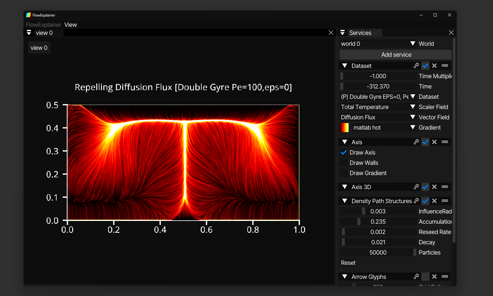

# FlowExplainer

A C# framework for visualizing and analyzing structures in heat transport.

Contains the implementation of the IEEE VIS 2026 short paper: [Visualizing Lagrangian Heat Transport Paths and Density Structures in Unsteady Heat Transfer](http://arxiv.org/abs/2607.00909)).

**Note:** This project is actively being developed as part of my PhD research but not yet in a state to be used in any production context..
